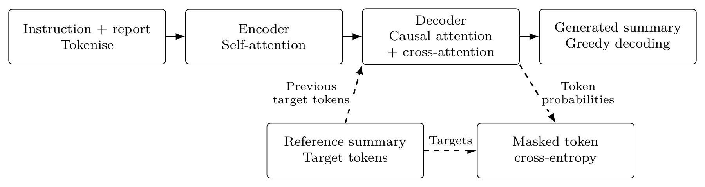
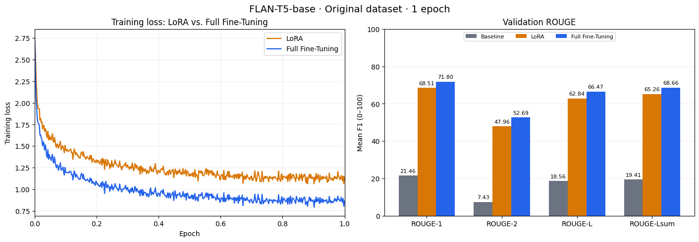
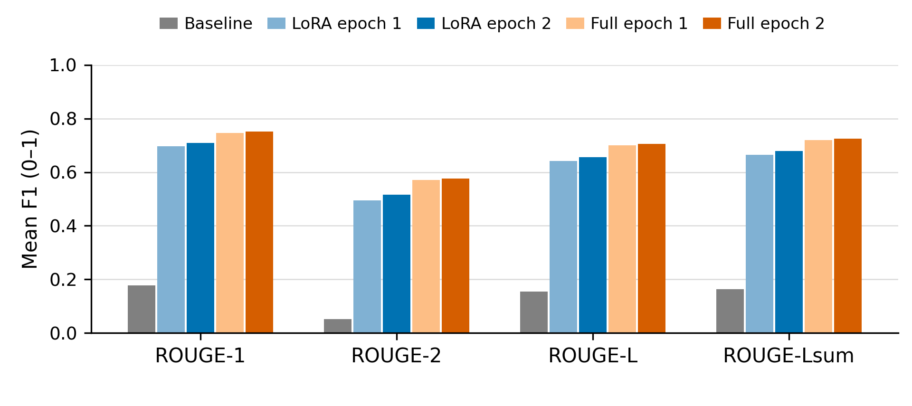
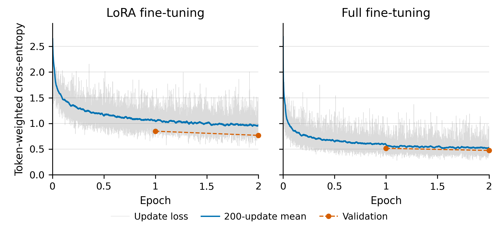

<!-- Maintained submission README. Edit this file directly and export it to README.pdf. -->

# Fine-tuning FLAN-T5 for Plain-Language Radiology Report Summarisation

Weiming Liang — 46375489  
COMP3710, Task 2.6

30 October 2026

[Problem](#sec-problem) · [Algorithm](#sec-algorithm) · [Feasibility review](#sec-feasibility) · [Example inputs and outputs](#sec-examples) · [Data](#sec-dataset) · [Installation and usage](#sec-usage) · [Reproducibility](#sec-experiments) · [Results](#sec-results) · [Error analysis](#sec-safety) · [Recommendation](#sec-recommendation) · [AI disclosure](#sec-ai-disclosure) · [References](#sec-references)

<a id="sec-problem"></a>

## 1. Problem Description and Project Overview

Radiology reports often use technical language that patients find difficult to understand. This prototype adapts FLAN-T5-base to produce plain-language summaries for the general public while preserving the findings, their location, whether they are present or absent, and any uncertainty. Given a radiology report, the model generates a summary that is easier for non-specialists to read while retaining the essential clinical information.

Using BioLaySumm LaymanRRG report–summary pairs, the project compares models trained via LoRA and full fine-tuning with the pretrained model in terms of summary quality and computing costs. The key investigation is whether fine-tuning these models can improve the summary quality both in fluency and factual accuracy. The outputs of the models will be evaluated for readability, factual accuracy, and overlap with reference summaries.

<a id="sec-algorithm"></a>

## 2. Algorithm / Architecture

As [Figure 1](#fig-model-workflow) shows, FLAN-T5 reads an instruction followed by a radiology report and writes a summary ([Raffel et al. 2020](#ref-t5); [Chung et al. 2024](#ref-flan)). Its encoder uses attention to connect relevant parts of the input, while its decoder writes one token (a word or part of a word) at a time. During training, the model receives the earlier tokens of the reference summary and learns to predict the next token; cross-entropy loss measures prediction error and guides weight updates. Full fine-tuning updates all model weights, whereas LoRA trains small added weight adjustments while keeping the original weights fixed ([Hu et al. 2022](#ref-lora)). To generate a summary, the model uses the instruction, report and its own preceding output, choosing the most likely next token until it reaches an end marker or the length limit.

<a id="fig-model-workflow"></a>



**Figure 1.** The instruction and report guide summary generation. Dashed arrows show how reference summaries are used for training and loss evaluation.

<a id="sec-feasibility"></a>

## 3. Feasibility Review

This review records the initial pilot and plan; Sections 7–10 report the subsequent custom-loop experiment.

**User Need, Scope & Acceptance Criteria**

The prototype rewrites radiology reports in plain language to facilitate communication between clinicians and patients. The engineering dilemma is to make summaries easier to read while preserving their meaning: higher ROUGE scores alone do not establish factual accuracy and readability. I propose the acceptance criteria below.

1.  Improve all four validation ROUGE scores over the pretrained baseline.

2.  Reduce hallucination and critical-omission rates and improve readability over baseline, assessed using a fixed rubric on 100 validation examples sampled uniformly without replacement (seed 42).

3.  Complete each epoch, including validation, within 60 minutes and 32 GB peak reserved GPU memory on an A100.

**Model Choice & Course Concepts**

The dataset BioLaySumm LaymanRRG contains **170,991 examples**: 150,454 training, 10,000 validation and 10,537 test rows. Training and validation reports have reference summaries; test reports do not. I chose [FLAN-T5-base](https://arxiv.org/abs/2210.11416) (**Hard** difficulty) over non-instruction-tuned T5 because its training on natural-language instructions aligns with the plain-language rewriting task. Its encoder–decoder Transformer uses attention, while adapting pretrained weights applies transfer learning. The comparison uses [LoRA](https://arxiv.org/abs/2106.09685), which trains 884,736 adapter parameters, with full fine-tuning of all 247,577,856 parameters.

**Preliminary Feasibility Evidence**

The pilot experiment used Hugging Face’s Seq2SeqTrainer on an A100 GPU. Separate LoRA and full fine-tuning runs each trained for one epoch on all 150,454 training examples. Both models were then evaluated alongside the unadapted baseline on all 10,000 validation examples.

Pilot ROUGE scores use a 0–100 scale. Time includes validation and checkpoint selection; VRAM is peak reserved memory in decimal GB.

| Method      | Val. loss |   R-1 |   R-2 |   R-L | R-Lsum | Time (min) | VRAM (GB) |
|:------------|----------:|------:|------:|------:|-------:|-----------:|----------:|
| Baseline    |     2.307 | 21.46 |  7.43 | 18.56 |  19.41 |          — |         — |
| LoRA        |     0.903 | 68.51 | 47.96 | 62.84 |  65.26 |       59.9 |     12.72 |
| Full tuning |     0.710 | 71.80 | 52.69 | 66.47 |  68.66 |       50.3 |     16.50 |

<a id="fig-feasibility-pilot"></a>



**Figure 2.** Training loss for LoRA and full fine-tuning (left); validation ROUGE for all three methods (right).

Both fine-tuned models improve all four ROUGE scores and meet the pilot time and memory limits. Full fine-tuning achieves higher ROUGE scores, while LoRA uses less memory. Factual accuracy and readability require separate review.

**Risks, Budget & Fallback**

**Risk:** Report text in 4,506 validation rows (45.06%) also appears in training after ignoring case and whitespace, potentially inflating scores. Following staff guidance, retain the official splits and assess overlap separately.

**Budget and next step:** Propose **10 additional A100 GPU-hours** for two epochs per method using the required custom training and evaluation code, plus generation and subset scoring. Test removal of exact report overlaps separately if time permits.

**Fallback:** If reliability remains unproven within budget, report baseline, LoRA and full-tuning performance, errors and resource use without claiming readiness for practical use.

<a id="sec-examples"></a>

## 4. Example Inputs and Outputs

Validation row 2 shows a report given to the prototype and the summaries it produces. Both trained models use the weights saved after epoch 2. Section [9.2](#sec-error-autopsies) compares LoRA and full fine-tuning at epoch 2 on four examples of factual errors and missing information despite readable wording.

**Source:** Chronic pulmonary changes

**Reference:** Long-term changes in the lungs are seen.

**Baseline:** This radiology report describes the changes in the lungs caused by chronic pulmonary changes.

**LoRA, epoch 2:** Long-term changes in the lungs are present.

**Full, epoch 2:** Long-term changes in the lungs are present.

Both trained models replace “chronic pulmonary changes” with everyday language about long-term changes in the lungs. The baseline repeats the technical phrase without explaining what it means.

<a id="sec-dataset"></a>

## 5. Dataset and Preprocessing

<a id="data-source-and-split-protocol"></a>

### 5.1. Data source and split protocol

The project uses the BioLaySumm 2025 LaymanRRG open-source track for text-to-text radiology report translation ([BioLaySumm 2025](#ref-dataset); [Xiao et al. 2025](#ref-biolaysumm)). It combines reports from PadChest, BIMCV-COVID19 and Open-i. The dataset creators provided the plain-language reference summaries. They translated PadChest and BIMCV-COVID19 reports into English before simplifying them. Training and validation rows contain a `radiology_report`, its `layman_report` reference summary and other information about the example.

The experiment uses the fixed dataset version `6783ab38f9de28c4372799346f51d3927ae7eb9a`. Following course staff guidance, the original training, validation and test splits are retained so the results can be compared with other work using them. Models are trained on the training split and scored on the validation split. The test split does not provide reference summaries, so it is excluded from training and scored evaluation.

| Split | Rows | Role |
|:---|---:|:---|
| Training | 150,454 | All pairs used by LoRA and full fine-tuning. |
| Validation | 10,000 | Common evaluation for the baseline and each saved epoch. |
| Test | 10,537 | Source-only batches; references are withheld and this split is excluded from training and scored evaluation. |

The example below shows the input report and reference summary in training row 2, using zero-based row numbering.

| Field | Text |
|:---|:---|
| `radiology_report` | The cardiomediastinal silhouette and pulmonary parenchyma show no significant pathological findings. |
| `layman_report` | The heart and the area around it, as well as the lung tissue, do not show any significant problems or abnormalities. |

<a id="prompting-and-tokenisation"></a>

### 5.2. Prompting and tokenisation

The tokenizer comes from the same fixed FLAN-T5-base version as the model. It splits text into tokens: small units such as words or parts of words. Each report is preceded by this instruction:

> `Simplify this radiology report for a layperson:`  
> `{report}`

The instruction and report together are limited to 512 tokens. The reference summary used to calculate prediction error (cross-entropy loss) is limited to 256 tokens. Text beyond these limits is cut off. No extra text cleaning or standardisation is applied, and no altered copies are created to expand the training data.

Within each batch, filler tokens (padding) extend shorter inputs to the length of the longest input. Reference summaries are padded separately to the longest reference in that batch. Reference padding is marked with $-100$, which tells the loss calculation to ignore those positions. Test batches contain input reports but no reference summaries.

For loss calculation, the model receives the earlier reference tokens to help predict the next one (teacher forcing). When generating a summary, it uses the instruction, report and its own previous output; it is not given the reference summary. An attention mask identifies which input positions contain real text rather than padding. ROUGE compares generated summaries with the complete references, even when the loss calculation uses shortened versions.

<a id="sec-usage"></a>

## 6. Implementation and Usage

### 6.1. Code organisation

The implementation uses explicit PyTorch training and evaluation loops. Hugging Face supplies the pretrained weights, tokenizer, padding tools and LoRA adapters; the final experiment does not use the Hugging Face `Trainer` API ([PyTorch](#ref-pytorch), [Transformers](#ref-transformers), [PEFT](#ref-peft)).

| File | Responsibility |
|---|---|
| [modules.py](modules.py) | Load FLAN-T5, attach LoRA and identify trainable parameters. |
| [dataset.py](dataset.py) | Load the official splits, tokenise reports/targets and collate batches. |
| [train.py](train.py) | Train, evaluate, save checkpoints and record losses, metrics and resources. |
| [predict.py](predict.py) | Load saved weights and generate single, batch or file predictions. |
| [utils.py](utils.py) | Handle seeds, device selection, timing, memory measurements and logging. |

### 6.2. Requirements and installation

The recorded experiment used Python **3.13.16**, PyTorch **2.11.0+cu130**, CUDA **13.0** and an **NVIDIA A100-SXM4-40GB**. The exact package pins in [requirements.txt](requirements.txt) are:

| Package           | Version | Purpose                                     |
|:------------------|:--------|:--------------------------------------------|
| `torch`           | 2.11.0  | Train and run the models.                   |
| `numpy`           | 2.1.3   | Work with numerical arrays.                 |
| `transformers`    | 4.56.2  | Load FLAN-T5 and its tokenizer.             |
| `peft`            | 0.17.1  | Add and load LoRA adapters.                 |
| `accelerate`      | 1.10.1  | Support model loading and device placement. |
| `datasets`        | 4.1.1   | Load the dataset splits.                    |
| `pyarrow`         | 23.0.1  | Read and store dataset tables.              |
| `pandas`          | 2.2.3   | Work with tabular results.                  |
| `tokenizers`      | 0.22.2  | Support fast text tokenisation.             |
| `sentencepiece`   | 0.2.1   | Support T5 text tokenisation.               |
| `huggingface-hub` | 0.36.2  | Download models and datasets.               |
| `safetensors`     | 0.8.0   | Read and save model weights.                |
| `rouge-score`     | 0.1.2   | Calculate ROUGE scores.                     |
| `matplotlib`      | 3.10.0  | Draw training and result plots.             |
| `PyYAML`          | 6.0.3   | Read YAML configuration files.              |
| `psutil`          | 5.9.5   | Support resource-use monitoring.            |

Run the following from the repository root to enter the implementation directory. All later commands and Python examples use that directory as their working directory.

```bash
cd recognition/FLAN-T5_46375489
```

Use a fresh Python 3.13 environment. For the recorded Linux/CUDA 13.0 setup, install PyTorch first, then the remaining packages:

```bash
python -m pip install torch==2.11.0 \
  --index-url https://download.pytorch.org/whl/cu130
python -m pip install -r requirements.txt
python -m pip check
```

For other hardware, use the corresponding [PyTorch 2.11.0 build](https://pytorch.org/get-started/previous-versions/). Initial model and dataset loading requires internet access unless the files are already cached.

### 6.3. Train the model

**Full fine-tuning is the first choice.** This command uses the main experiment's training and generation hyperparameters:

```bash
python train.py --config configs/full.yaml \
  --epochs 2 --batch-size 16 --eval-batch-size 32 \
  --num-beams 1 --bf16 --device cuda \
  --save-every-epoch --output-dir outputs/full
```

Use LoRA only if full fine-tuning cannot meet the resource limits and a LoRA trial can. Replace `configs/full.yaml` with `configs/lora.yaml` and `outputs/full` with `outputs/lora`; keep the other overrides. The YAML files alone default to five epochs, batch size four and four beams, so these overrides matter. Similar measured training times mean LoRA should mainly be considered for its memory and checkpoint-storage savings.

The configurable options below use the shared experiment settings; the LoRA-specific values apply only when LoRA is selected. Command-line arguments override YAML values. YAML keys use underscores instead of hyphens and omit the leading `--`.

| Option | Example value | Controls |
|:---|:---|:---|
| `--epochs` | 2 | Passes through the training data. |
| `--batch-size` | 16 | Reports per training batch. |
| `--learning-rate` | `2e-4` | Learning rate for weight updates. |
| `--weight-decay` | 0.01 | Weight shrinkage during updates. |
| `--gradient-accumulation-steps` | 1 | Batches combined before a weight update. |
| `--max-grad-norm` | 1.0 | Gradient clipping limit. |
| `--lora-r` | 8 | Rank of the LoRA adapter matrices. |
| `--lora-alpha` | 16 | LoRA scaling, applied as $\alpha/r$. |
| `--lora-dropout` | 0.05 | LoRA dropout probability. |
| `--max-input-length` | 512 | Maximum input tokens, including the prompt. |
| `--max-target-length` | 256 | Maximum reference tokens used for loss. |
| `--max-new-tokens` | 256 | Maximum generated tokens. |
| `--num-beams` | 1 | Decoding beams; 1 gives greedy generation. |

Related controls are `--eval-batch-size 32`, `--seed 42` and `--bf16`; `--no-bf16` disables BF16. For a small pipeline check before a full run:

```bash
python train.py --config configs/smoke.yaml
```

This runs one epoch on 16 training and eight validation examples, using batch size two and shorter token limits. It checks the pipeline; resource use on this tiny run does not establish that the full workload will fit.

With `--save-every-epoch`, the two-epoch run writes `outputs/full/epoch-01`, `epoch-02` and `best_checkpoint.json`. The JSON file identifies the checkpoint with the lowest validation loss. Checkpoints include weights or adapters, the tokenizer, `config_run.json` and `training_state.pt`. Logs and plots include `history.json`, `step_history.csv`, `resources.json`, `plots/losses.png` and `plots/metrics.png`. Checkpoints can be loaded for prediction; automatic training resume is not implemented.

Keep datasets and saved model weights out of Git; retain code, configuration and report figures in the submission.

This command demonstrates ordinary usage. Reproducing the exact recorded experiment also requires the revision pins, controlled batch order and evaluation procedure in Section [7](#sec-experiments).

### 6.4. Generate summaries from saved weights

`predict.py` exposes a Python API. For a full epoch-2 checkpoint:

```python
import torch
from predict import RadiologyPredictor

predictor = RadiologyPredictor.from_checkpoint(
    "outputs/full/epoch-02",
    fine_tuning_mode="full",
    device="cuda",
    batch_size=32,
    max_input_length=512,
    max_new_tokens=256,
    num_beams=1,
)
with torch.autocast("cuda", dtype=torch.bfloat16):
    print(predictor.predict("Chronic pulmonary changes"))
```

For LoRA, use `outputs/lora/epoch-02`, `fine_tuning_mode="lora"` and the same base-model revision used during training. `from_checkpoint()` does not automatically restore inference settings from `config_run.json`, so pass the intended settings explicitly.

`predict_batch()` accepts a list of report strings. `predict_file()` reads a JSON list such as:

```json
[{"radiology_report": "Chronic pulmonary changes"}]
```

It writes corresponding `layman_report` summaries and a separate `<output-stem>_metrics.json` measurements file. Section [4](#sec-examples) shows saved inputs and outputs from the recorded experiment.

### 6.5. Evaluate a checkpoint or the pretrained baseline

Load the checkpoint configuration, prepare the data and call `evaluate()`:

```python
import json
from pathlib import Path
from dataset import RadiologyData
from predict import RadiologyPredictor
from train import RadiologyTrainer

checkpoint = Path("outputs/full/epoch-02")
config = json.loads((checkpoint / "config_run.json").read_text())
config["training"]["device"] = "cuda"

predictor = RadiologyPredictor.from_checkpoint(
    checkpoint,
    model_name=config["model"]["model_name"],
    fine_tuning_mode=config["model"]["fine_tuning_mode"],
    model_revision=config["model"].get("model_revision"),
    device="cuda",
)
data = RadiologyData(predictor.tokenizer, config["data"])
data.load()
metrics = RadiologyTrainer(predictor.model, data, config).evaluate()
print(metrics)
```

`evaluate()` scores the validation split and returns `loss`, four ROUGE scores and generation measurements. The ordinary data loader also prepares the official test sources without target labels; those rows are not used for scored evaluation. This API does not itself save all prediction texts or perform the experiment harness's independent-checkpoint resource profiling.

The **implemented baseline** uses pretrained `google/flan-t5-base` without adapters or task-specific weight updates. Load it in full mode, prepare the same validation data and call `evaluate()` **before any `fit()` call**. This separates the effect of fine-tuning from the pretrained model's existing ability.

<a id="sec-experiments"></a>

## 7. Experimental Design and Reproducibility

<a id="controlled-comparison"></a>

### 7.1. Controlled comparison

Pretrained FLAN-T5-base, LoRA and full fine-tuning were compared in separate A100 GPU sessions. Both training methods completed two passes (epochs) through 150,454 training reports. The baseline and four saved models were evaluated on the same 10,000 validation reports in their original order.

All runs used FLAN-T5-base revision `7bcac572ce56db69c1ea7c8af255c5d7c9672fc2`, the dataset version in Section [5](#sec-dataset), and identical prompts and generation settings. Seed 42 controlled randomness. A separate random generator, seeded with $42+\text{epoch}$, gave both training methods the same shuffled batches in each epoch.

Before checkpoint evaluation, the experiment scripts moved the training model and optimiser state to CPU memory, then reloaded the saved weights. LoRA adapters remained separate from the base weights. The checkpoint with the lowest validation loss was selected as best.

<a id="scoring-and-measurement"></a>

### 7.2. Scoring and measurement

**Scores.** Both metrics were calculated on all 10,000 validation reports, once for the pretrained baseline and after each LoRA/full-tuning epoch, with weights fixed.

- **Validation loss:** Average cross-entropy over non-padding reference tokens (up to 256 per summary), using the report and earlier reference tokens. Lower is better.
- **ROUGE:** Mean per-report ROUGE-1/2/L/Lsum F1 scores (0–1), measuring wording overlap between summaries generated without references and the complete references; higher is better ([Lin 2004](#ref-rouge)). Scoring uses `rouge-score` 0.1.2 with word stemming; ROUGE-Lsum also uses sentence boundaries.

**Time.** Training time excludes initial loading, evaluation and checkpoint operations. Total evaluation time includes generation, text processing, data transfer, loss calculation, scoring and output writing. Loading is reported separately.

**Generation speed.** Tokens per second are measured during generation only. Counts include the end-of-sequence token (EOS), but exclude the decoder-start token and later padding. Training and generation timers wait for GPU work to finish before starting and stopping.

**Memory.** Peak GPU memory is reported in GiB: allocated memory holds active tensors; reserved memory also includes PyTorch’s cached space.

### 7.3. Hyperparameters and dataset version

**Dataset version:** `6783ab38f9de28c4372799346f51d3927ae7eb9a`.

<a id="tab-experiment-settings"></a>

**Table 1.** Experiment hyperparameters. LoRA settings apply only to the adapter-based runs.

| Setting | Value |
|:---|:---|
| Training | 2 epochs; batch size 16; gradient accumulation 1 |
| Optimisation | AdamW ([Loshchilov and Hutter 2019](#ref-adamw)); constant learning rate $2\times10^{-4}$; weight decay 0.01; gradient-norm limit 1.0 |
| LoRA | Rank 8; $\alpha=16$; dropout 0.05; attention query/value projections |
| Lengths | Prompted input at most 512 tokens; loss targets at most 256 tokens |
| Generation | At most 256 new tokens; greedy decoding; one beam; no sampling |
| Evaluation | Batch size 32 |
| Random seed | 42 |
| Precision | BF16 autocast |

<a id="sec-results"></a>

## 8. Quantitative Results and Resource Profiling

<a id="validation-performance"></a>

### 8.1. Validation performance

Both training methods improve all four ROUGE scores over the baseline (Figure [3](#fig-rouge-comparison); Table [2](#tab-validation-results)). At epoch 2, full fine-tuning reaches ROUGE-Lsum 0.7241, compared with 0.6788 for LoRA and 0.1625 for the baseline. Full fine-tuning scores 0.0454 higher than LoRA on the 0–1 scale, calculated from unrounded scores. Each evaluation uses the same 10,000 validation examples in the same order.

<a id="tab-validation-results"></a>

**Table 2.** ROUGE F1 scores averaged across examples, and validation loss averaged across reference tokens. All five evaluations use the complete official validation split.

| Model/checkpoint |    R-1 |    R-2 |    R-L | R-Lsum | Val. loss |
|:-----------------|-------:|-------:|-------:|-------:|----------:|
| Baseline         | 0.1779 | 0.0520 | 0.1535 | 0.1625 |    2.3083 |
| LoRA, epoch 1    | 0.6962 | 0.4945 | 0.6418 | 0.6645 |    0.8492 |
| LoRA, epoch 2    | 0.7099 | 0.5164 | 0.6566 | 0.6788 |    0.7676 |
| Full, epoch 1    | 0.7470 | 0.5711 | 0.6998 | 0.7188 |    0.5150 |
| Full, epoch 2    | 0.7520 | 0.5760 | 0.7054 | 0.7241 |    0.4729 |

<a id="fig-rouge-comparison"></a>



**Figure 3.** All four ROUGE scores for the baseline and four saved models, evaluated on the same 10,000 validation reports.

The second epoch increases ROUGE-Lsum by 0.0143 for LoRA and 0.0053 for full fine-tuning. Both validation losses also fall. The final comparison uses epoch 2.

<a id="training-behaviour-and-cost"></a>

### 8.2. Training behaviour and cost

Average training loss falls from 1.2317 to 1.0012 for LoRA and from 0.7045 to 0.5393 for full fine-tuning. Loss falls most quickly early in training (Figure [4](#fig-training-history)). Training loss is measured while dropout is active and the model’s weights are still being updated. Validation loss is measured with dropout turned off and the saved weights held fixed. These different conditions help explain why the two losses are at different levels.

<a id="fig-training-history"></a>



**Figure 4.** Training loss at each update, a smoothed average over the most recent updates (up to 200, weighted by token count), and loss on the complete validation set at each saved epoch.

LoRA updates 884,736 parameters, 99.64% fewer than full fine-tuning, and reduces peak allocated training memory by 18.6%. Both methods run the base model and keep its intermediate results (activations) in memory. Their training times are similar: 58.18 minutes for LoRA and 58.01 minutes for full fine-tuning over two epochs.

<a id="tab-training-resources"></a>

**Table 3.** Parameter counts, total training time over two epochs, and the highest allocated and reserved GPU memory recorded during training. Allocated memory holds tensors in use; reserved memory also includes cached blocks. All timings were recorded on an A100-SXM4-40GB.

| Model    | Total (M) | Updated (M) | Train min | Alloc. GiB | Reserv. GiB |
|:---------|----------:|------------:|----------:|-----------:|------------:|
| Baseline |   247.578 |       0.000 |         – |          – |           – |
| LoRA     |   248.463 |       0.885 |     58.18 |      18.71 |       23.37 |
| Full     |   247.578 |     247.578 |     58.01 |      22.98 |       26.52 |

<a id="inference"></a>

### 8.3. Inference

The final fully fine-tuned model generates 374.26 tokens/s, compared with 279.69 for LoRA with its adapters kept separate from the base model (unmerged LoRA) (Table [4](#tab-inference-resources)). The baseline generates fewer tokens per report and finishes its evaluation sooner. Total evaluation time averages 106.07, 179.30 and 138.19 ms per report for the baseline, LoRA and full fine-tuning. These averages come from evaluating reports in batches of 32 and dividing the total time by 10,000 reports.

<a id="tab-inference-resources"></a>

**Table 4.** Summary generation by the final saved models over 10,000 validation reports. Generation speed uses timing that waits for GPU work to finish. Total evaluation time also includes calculating loss, scoring summaries and writing outputs. Peak memory lists allocated memory followed by reserved memory, in GiB.

| Model | Generate s | Evaluate s | Average evaluation ms/report | Tokens/s | Mean tokens | Peak GiB (allocated / reserved) |
|---|---:|---:|---:|---:|---:|---:|
| Baseline | 1010.39 | 1060.72 | 106.07 | 271.89 | 27.47 | 3.81 / 5.62 |
| LoRA | 1729.58 | 1793.04 | 179.30 | 279.69 | 48.38 | 3.82 / 5.68 |
| Full | 1320.07 | 1381.87 | 138.19 | 374.26 | 49.40 | 3.82 / 5.63 |

The average milliseconds per report are amortised over batches of 32 and include the full evaluation workload. They are not single-request latency measurements. Training minutes in Table 3 exclude evaluation and checkpoint operations.

<a id="sec-safety"></a>

## 9. Clinical Fidelity and Readability

<a id="sec-quality-review"></a>

### 9.1. Assessment of the second acceptance criterion

The planned review randomly selected 100 of the 10,000 validation reports using seed 42. Every report had the same chance of selection, and none was selected twice. Three AI assessors reviewed the predictions from all five checkpoints for these reports, giving 500 evaluations per assessor. These were ChatGPT (Pro effort; model version not recorded) ([ChatGPT 2026](#ref-qualityreview)), Gemini 4 Argon ([Gemini 2026](#ref-geminiqualityreview)), and Claude Opus 5.5 (High effort) ([Claude 2026](#ref-claudequalityreview)). Each gave scores and brief reasons for every complete prediction. Their recorded rating criteria are summarised below. The original radiology report is the basis for checking the facts; the reference provides additional guidance on plain wording. If they disagree, the original report takes priority.

- **Hallucination (H, 0/1).** Score 0 when the original report supports all factual claims; score 1 when at least one clinical claim is unsupported, made up or contradicts the report. Checks cover diagnoses, procedures, medical history, location, side of the body, measurements, whether a finding is present or absent, and how certain a diagnosis is. Accurate rewording and generic or repetitive wording alone are not hallucinations.

- **Critical omission (O, 0/1).** Score 0 when all medically essential information is kept; score 1 when an important finding, detail that qualifies a finding, or recommendation is missing or not properly communicated. Checks cover abnormalities, important findings reported as absent, location and side of the body, changes over time, uncertainty, follow-up, measurements and device position. Repeated information, writing style and medically insignificant details are excluded.

The two error flags are scored separately: both may be 1, but one does not automatically imply the other. **Readability (R, 1–10)** is a whole-number score for how easily an adult without medical training can understand the text. It is scored separately from accuracy and completeness. It considers whether medical terms are explained, how clear and well organised the text is, grammar, repetition, cut-off text and whether the length is appropriate.

| Readability score | Interpretation |
|:---|:---|
| 1–2 | Incoherent, severely repetitive or largely unintelligible. |
| 3–4 | Difficult to understand; substantial jargon or confusing language. |
| 5–6 | Moderately understandable; some unexplained terminology or awkward phrasing. |
| 7–8 | Generally clear and accessible, with minor readability issues. |
| 9–10 | Exceptionally clear, natural, concise and understandable without medical knowledge. |

<a id="tab-quality-review"></a>

**Table 5.** Each AI assessor reviewed the same 100 validation reports for each checkpoint. Error rates are the percentage of outputs with at least one flagged error. Readability is the mean $\pm$ sample standard deviation on a 1–10 scale. These statistics were recalculated from each assessor’s scores.

| AI assessor | Model/checkpoint | Hallucinations | Critical omissions | Readability |
|:---|:---|---:|---:|---:|
| ChatGPT | Baseline | 38% | 71% | $5.14 \pm 2.16$ |
| ChatGPT | LoRA, epoch 1 | 17% | 15% | $8.06 \pm 1.92$ |
| ChatGPT | LoRA, epoch 2 | 17% | 13% | $8.27 \pm 1.72$ |
| ChatGPT | Full, epoch 1 | 16% | 7% | $8.67 \pm 1.52$ |
| ChatGPT | Full, epoch 2 | 9% | 9% | $8.83 \pm 1.30$ |
| Gemini 4 Argon | Baseline | 39% | 76% | $4.52 \pm 1.42$ |
| Gemini 4 Argon | LoRA, epoch 1 | 16% | 24% | $8.51 \pm 1.54$ |
| Gemini 4 Argon | LoRA, epoch 2 | 13% | 25% | $8.76 \pm 1.30$ |
| Gemini 4 Argon | Full, epoch 1 | 9% | 11% | $9.19 \pm 1.07$ |
| Gemini 4 Argon | Full, epoch 2 | 4% | 14% | $9.36 \pm 0.88$ |
| Claude Opus 5.5 | Baseline | 39% | 69% | $3.93 \pm 1.35$ |
| Claude Opus 5.5 | LoRA, epoch 1 | 19% | 6% | $7.63 \pm 1.93$ |
| Claude Opus 5.5 | LoRA, epoch 2 | 14% | 4% | $7.79 \pm 1.79$ |
| Claude Opus 5.5 | Full, epoch 1 | 11% | 4% | $8.30 \pm 1.46$ |
| Claude Opus 5.5 | Full, epoch 2 | 7% | 5% | $8.58 \pm 1.16$ |

All three assessors give all four fine-tuned checkpoints lower error rates and higher average readability than the baseline. Each AI assessment therefore supports the second acceptance criterion. Full tuning at epoch 2 has the lowest hallucination rate and highest readability for every assessor. Full epoch 1 has the fewest omissions for ChatGPT and Gemini, and ties with LoRA epoch 2 for Claude.

Omission rates vary by assessor: LoRA epoch 2 ranges from 4% to 25%, and full epoch 2 from 5% to 14%. The ratings are reported separately. Combining them would not provide independent samples because all assessors reviewed the same reports. The AI assessors knew which checkpoint produced each output, and clinicians have not checked their judgments. Reviews by clinicians and readers without medical training are the next step. The cases below use the original ChatGPT ratings.

Although these are advanced models, they remain large language models, and their outputs and scores can contain occasional errors. Their judgments therefore require fact-checking against the original reports through case-by-case review.

<a id="sec-error-autopsies"></a>

### 9.2. Qualitative error autopsies

These four cases from the 100-report assessment illustrate why high readability scores do not guarantee clinical fidelity. They were selected because the epoch 2 outputs score 7–9 for readability yet have flagged hallucinations or critical omissions. Each shows the original radiology report and reference layman report, followed by the complete predictions from LoRA and full fine-tuning at epoch 2. H/O/R shows the recorded hallucination flag, critical omission flag and readability score: 1 flags an error; readability ranges from 1 to 10.

<a id="hallucinations"></a>

#### 9.2.1. Hallucinations

Both epoch 2 checkpoints receive R=9 and H=1 in these examples.

**Row 2045: Simplification introduces unsupported clinical claims.**

**Original radiology report:** Inspiratory effort is adequate. **Left basal alveolar infiltrate**, ruling out parenchymal consolidation. Aortic elongation with supra-aortic trunk elongation. Dorsal kyphosis with osteopenia and degenerative changes.

**Layman report (reference):** The breathing effort is good. There’s **a patchy area in the lower left part of the lung**, but it’s not a solid mass. The aorta, the main blood vessel, is stretched out, and the branches above it are also elongated. There’s a humpback posture with weak bones and some wear and tear in the spine.

| Checkpoint | H/O/R | Prediction |
|:---|:--:|:---|
| LoRA, epoch 2 | 1/0/9 | The breathing effort is normal. There is a **buildup of fluid** in the left lower part of the lung, which could be a sign of lung tissue becoming solid. The main blood vessel coming out of the heart is stretched out, and the branches above it are stretched out. The upper back is curved, with bone loss and wear and tear. |
| Full, epoch 2 | 1/0/9 | The breathing effort is good. There is a patch of **lung inflammation** at the bottom left, but it’s not a solid area of lung tissue. The main blood vessel coming out of the heart and the branches above it are stretched out. The upper back is curved, and there is a decrease in bone density and wear and tear changes. |

LoRA describes the lung finding as fluid buildup, while full fine-tuning calls it inflammation. The original report does not establish either interpretation, so both outputs receive H=1. Both are easy to read (R=9), but their clear wording adds unsupported clinical meaning.

**Row 6065: Normal findings are changed during simplification.**

**Original radiology report:** No consolidations are identified in the lung parenchyma. The cardiomediastinal silhouette and **pulmonary hila** are within normal limits. No other significant findings are noted.

**Layman report (reference):** No signs of pneumonia are found in the lung tissue. The heart and the area around it, as well as the **lung’s main structures**, are all normal. There are no other important issues observed.

| Checkpoint | H/O/R | Prediction |
|:---|:--:|:---|
| LoRA, epoch 2 | 1/0/9 | No signs of lung infections are found in the lung tissue. The heart and middle chest area and the **lung bases** are normal. There are no other important issues found. |
| Full, epoch 2 | 1/0/9 | No signs of pneumonia are found in the lung tissue. The heart and the area around it, as well as the **lung bases**, are all normal. There are no other important issues noted. |

Both outputs replace normal pulmonary hila with normal lung bases. These are different locations, so both receive H=1 despite R=9. The sentences sound natural and reassuring, but the claim about the lung bases is not supported by the original report.

<a id="omission-of-important-information"></a>

#### 9.2.2. Omission of important information

Both epoch 2 outputs have O=1 in each example, with readability scores of 7–8.

**Row 5155: Readable summaries omit redistribution of blood flow.**

**Original radiology report:** Cardiomegaly. Prominent hila of vascular origin with **vascular redistribution** and a mild interstitial pattern, without significant changes compared to the study from yesterday.

**Layman report (reference):** The heart is enlarged. The blood vessels near the lungs are prominent, indicating a **redistribution of blood flow** and a mild pattern of fluid in the lungs, which hasn’t changed much compared to the previous day’s examination.

| Checkpoint | H/O/R | Prediction |
|:---|:--:|:---|
| LoRA, epoch 2 | 0/1/8 | The heart is enlarged. The areas where the blood vessels enter the lungs are prominent, likely due to blood vessel issues. There is a mild pattern in the lung tissue, but it hasn’t changed much since the study done yesterday. |
| Full, epoch 2 | 1/1/8 | The heart is enlarged. The areas where the blood vessels enter the lungs are prominent, likely due to blood vessel issues, and there is a mild pattern of fluid in the lung tissues. This is similar to what was seen in the study from yesterday. |

Both outputs retain the enlarged heart and the comparison with yesterday’s study, but omit the reported redistribution of blood flow. The vague phrase “blood vessel issues” does not communicate this specific finding. Both receive R=8 and O=1, showing that readable wording can still leave out important information. The full output also interprets the interstitial pattern as fluid in the lung tissues, which the source does not establish (H=1).

**Row 1654: Readable summaries lose the location of a finding.**

**Original radiology report:** No images of consolidation or significant pulmonary infiltrates are identified. The **left pulmonary hilum** is prominent. Comparison with the previous study dated 31 01 2011 shows no significant changes.

**Layman report (reference):** There are no signs of pneumonia or major lung issues on the images. The **area where the left lung connects to the bronchus** is more noticeable. Comparing this to the previous study from January 31, 2011, there are no significant changes.

| Checkpoint | H/O/R | Prediction |
|:---|:--:|:---|
| LoRA, epoch 2 | 0/1/7 | No signs of lung infections or major lung infections are found. The left lung area is more noticeable. Comparing this to the previous study from January 31, 2011, there are no significant changes. |
| Full, epoch 2 | 0/1/7 | No signs of lung infections or serious lung issues are found. The left lung area is more noticeable. Comparing this to the previous study from January 31, 2011, there are no significant changes. |

Both outputs replace the prominent left hilum with a more noticeable “left lung area”. They preserve the left side and the comparison with the earlier study, but lose the specific location. Both receive R=7 and O=1, showing that readable wording can still omit an important detail.

<a id="sec-sentence-overlap"></a>

### 9.3. Repeated report–summary pairs

Data leakage can occur when training and validation contain the same examples, slightly reworded copies, or related reports from the same patient or study. This check covers only identical report–summary pairs.

Both the complete source report and target summary must match the same training row after standardising character forms (Unicode NFKC), capitalisation and spacing. All wording, numbers and punctuation are kept. This finds 2,380 matches among 10,000 validation reports (23.80%). Table [6](#tab-exact-pair-overlap) compares their scores with the remaining 7,620 reports.

<a id="tab-exact-pair-overlap"></a>

**Table 6.** Mean ROUGE F1 (0–1) for **matching / remaining** validation reports. Scores use the original prediction and reference texts.

| Checkpoint   |             R-1 |             R-2 |             R-L |          R-Lsum |
|:-------------|----------------:|----------------:|----------------:|----------------:|
| Baseline     | 0.1352 / 0.1912 | 0.0303 / 0.0588 | 0.1263 / 0.1620 | 0.1265 / 0.1738 |
| LoRA epoch 1 | 0.8143 / 0.6593 | 0.6778 / 0.4372 | 0.7997 / 0.5925 | 0.8000 / 0.6222 |
| LoRA epoch 2 | 0.8271 / 0.6733 | 0.7036 / 0.4579 | 0.8139 / 0.6075 | 0.8142 / 0.6365 |
| Full epoch 1 | 0.8442 / 0.7166 | 0.7330 / 0.5206 | 0.8346 / 0.6578 | 0.8347 / 0.6826 |
| Full epoch 2 | 0.8425 / 0.7238 | 0.7165 / 0.5321 | 0.8329 / 0.6656 | 0.8330 / 0.6901 |

**Three matching examples.** Each pair has identical complete reports and reference summaries. Tables show all five checkpoints’ complete predictions. Row numbers start at zero.

1.  **Training row 3,677; validation row 247.**  
    **Radiology report (both):** Cardiomegaly.  
    **Layman reference (both):** The heart is enlarged.

    | Checkpoint   | Prediction                                                |
    |:-------------|:----------------------------------------------------------|
    | Baseline     | This radiology report is for the following: Cardiomegaly. |
    | LoRA epoch 1 | The heart is enlarged.                                    |
    | LoRA epoch 2 | The heart is enlarged.                                    |
    | Full epoch 1 | The heart appears enlarged.                               |
    | Full epoch 2 | The heart is enlarged.                                    |

2.  **Training row 48,706; validation row 3,032.**  
    **Radiology report (both):** Left pleural effusion.  
    **Layman reference (both):** There is fluid buildup on the left side of the chest.

    | Checkpoint   | Prediction                                                 |
    |:-------------|:-----------------------------------------------------------|
    | Baseline     | This radiology report describes the left pleural effusion. |
    | LoRA epoch 1 | There is fluid buildup on the left side of the chest.      |
    | LoRA epoch 2 | There is fluid buildup on the left side of the chest.      |
    | Full epoch 1 | There is fluid buildup on the left side of the chest.      |
    | Full epoch 2 | There is fluid buildup on the left side of the chest.      |

3.  **Training row 85,059; validation row 424.**  
    **Radiology report (both):** Scoliotic posture. No significant findings.  
    **Layman reference (both):** The person has a curved spine posture, but there are no significant issues found.

    | Checkpoint | Prediction |
    |:---|:---|
    | Baseline | This report summarizes the results of a scolioscopy examination of a scolioscopy patient. |
    | LoRA epoch 1 | The person is in a curved posture. There are no important issues found. |
    | LoRA epoch 2 | The person is bending forward. There are no important issues found. |
    | Full epoch 1 | The person has a curved spine posture. There are no important issues found. |
    | Full epoch 2 | The person has a curved spine posture. There are no important issues found. |

    **Reference variation for this report.** Across training and validation, this exact radiology report occurs in three rows with two distinct layman references. Training row 85,059 and validation row 424 share the reference shown above. Training row 34,971 instead has: “The person has a curved spine posture, also known as scoliosis. There are no significant issues found.” These are all matching locations in the two splits.

**Effect on scores.** Fine-tuned models score higher on repeated pairs; the baseline scores lower. For full epoch 2, ROUGE-Lsum is 0.8330 on matches and 0.6901 on the remaining reports. Including matches raises the overall mean to 0.7241 (+0.0340), so the overall score does not represent performance on new pairs alone. Matching reports are also much shorter: 4.7 versus 29.1 source words on average. This comparison cannot separate repetition from report length; controlled retraining (Section [10](#sec-recommendation)) is needed to distinguish their effects.

<a id="sec-recommendation"></a>

## 10. Engineering Recommendation and Limitations

<a id="recommendation"></a>

### 10.1. Recommendation

Use the full epoch 2 checkpoint as the default prototype for further validation. It has the strongest overall ROUGE scores and the highest ROUGE-Lsum on validation reports without exact training matches (Section [9.3](#sec-sentence-overlap)). Compare it with full epoch 1 in clinician review, since epoch 1 has fewer flagged omissions (7% versus 9% in the original assessment).

Use LoRA only if full fine-tuning cannot meet resource limits and a LoRA trial can. Its main advantages are lower training memory and smaller saved adapters; training times are similar, and the base model is still required.

<a id="next-engineering-steps"></a>

### 10.2. Next engineering steps

1.  **Check resources.** Trial full fine-tuning on the intended GPU with long inputs and targets, measuring peak memory, total runtime and disk needs. Reduce batch sizes and use gradient accumulation if needed; trial LoRA only if full fine-tuning still exceeds limits.

2.  **Remove exact overlaps.** Exclude training pairs matching validation and record the removals. Retrain for two epochs with validation and settings fixed, and compare with a control that removes the same number of training pairs at random.

3.  **Check clinical accuracy.** Have clinicians compare epoch 1/2 outputs against the same 100 source reports in random order, with model labels hidden. Add automated checks for unsupported or missing findings, location, negation and uncertainty, and validate these checks against clinician judgments.

4.  **Check patient understanding.** Test clinician-reviewed summaries with readers without medical training. Show source and summary together, flag truncated inputs and require clinician approval before patient use.

<a id="limits-and-future-work"></a>

### 10.3. Limits and future work

**Further training.** Full fine-tuning’s validation loss fell from 0.5150 to 0.4729, supporting a trial of more epochs after reducing overlap. Two epochs and overlapping data do not rule out overfitting. Monitor validation loss and generated summaries, stop when performance no longer improves, and retain the best checkpoint.

**Deeper leakage analysis.** Extend Section [9.3](#sec-sentence-overlap) beyond exact pairs to near-duplicates, paraphrases and related patient/study reports where identifiers are available. Remove confirmed training-side overlaps and linked records, document exclusions, and retrain using the fixed validation set and random-removal control above.

<a id="sec-ai-disclosure"></a>

## 11. Artificial Intelligence Usage Disclosure

I used OpenAI Codex, ChatGPT, Gemini, Claude, Claude Code and the Antigravity IDE to support the project. I determined the investigation’s scope, selected the comparisons and directed revisions. I manually reviewed generated code and other content and sought clarification where needed.

- **Concepts and planning.** AI supported conceptual clarification, literature interpretation and experimental planning, including model selection, evaluation criteria and resource constraints.

- **Implementation and testing.** AI assisted with code development, refactoring and debugging. Assistants checked changes through separate-agent reviews, controlled CPU tests, before-and-after comparisons, checkpoint checks and small GPU test runs.

- **Experiments and analysis.** Assistants executed the training and evaluation runs, verified metrics and examples against saved results and dataset records, and analysed dataset overlap and model errors. ChatGPT, Gemini and Claude provided clinical-fidelity and readability scores (Section [9.1](#sec-quality-review)); automated checks verified score completeness and the reported summary calculations.

- **Writing and presentation.** AI assisted with report drafting and revision, including figures, tables, plain-language explanations, usage instructions and source attribution. I directed the organisation and presentation and requested corrections supported by project evidence.
  
<a id="sec-references"></a>

## 12. References and Attribution

Google provides the pretrained model weights and tokenizer ([Google 2022](#ref-flanmodel)). BioLaySumm provides the reports and reference summaries ([BioLaySumm 2025](#ref-dataset); [Xiao et al. 2025](#ref-biolaysumm)). PyTorch, Transformers and PEFT provide the underlying software libraries ([Paszke et al. 2019](#ref-pytorch); [Wolf et al. 2020](#ref-transformers); [Mangrulkar et al. 2022](#ref-peft)). The project adds the task settings, custom training and evaluation loops, measurement code and analysis. AI assistance is described in Section [11](#sec-ai-disclosure).

<a id="refs"></a>

<a id="ref-dataset"></a>

BioLaySumm. 2025. “BioLaySumm2025-LaymanRRG-opensource-track.” Hugging Face dataset repository. <https://huggingface.co/datasets/BioLaySumm/BioLaySumm2025-LaymanRRG-opensource-track>.

<a id="ref-qualityreview"></a>

ChatGPT. 2026. “Evaluation Summary: Clinical Fidelity and Readability Across Five Checkpoints.” Shared AI rubric assessment. <https://chatgpt.com/share/6ae3bef4-1b18-83ec-abcd-f24c58895884>.

<a id="ref-flan"></a>

Chung, Hyung Won, Le Hou, Shayne Longpre, et al. 2024. “Scaling Instruction-Finetuned Language Models.” *Journal of Machine Learning Research* 25 (70): 1–53. <https://www.jmlr.org/papers/v25/23-0870.html>.

<a id="ref-claudequalityreview"></a>

Claude. 2026. “Claude Opus 5.5: Clinical Fidelity and Readability Assessment Across Five Checkpoints.” Shared AI assessment chat. <https://claude.ai/share/3afe55b7-b9a0-43e2-8a61-a37bea190f04>.

<a id="ref-geminiqualityreview"></a>

Gemini. 2026. “Gemini 4 Argon: Clinical Fidelity and Readability Assessment Across Five Checkpoints.” Shared AI assessment chat. <https://share.gemini.google/oiyo6aFaEsVp>.

<a id="ref-flanmodel"></a>

Google. 2022. “FLAN-T5-base: Pretrained Checkpoint and Model Card.” Hugging Face model repository. <https://huggingface.co/google/flan-t5-base>.

<a id="ref-lora"></a>

Hu, Edward J., Yelong Shen, Phillip Wallis, et al. 2022. “LoRA: Low-Rank Adaptation of Large Language Models.” In *International Conference on Learning Representations*. <https://arxiv.org/abs/2106.09685>.

<a id="ref-rouge"></a>

Lin, Chin-Yew. 2004. “ROUGE: A Package for Automatic Evaluation of Summaries.” In *Text Summarization Branches Out*, 74–81. Association for Computational Linguistics. <https://aclanthology.org/W04-1013/>.

<a id="ref-adamw"></a>

Loshchilov, Ilya, and Frank Hutter. 2019. “Decoupled Weight Decay Regularization.” In *International Conference on Learning Representations*. <https://arxiv.org/abs/1711.05101>.

<a id="ref-peft"></a>

Mangrulkar, Sourab, Sylvain Gugger, Lysandre Debut, et al. 2022. “PEFT: State-of-the-Art Parameter-Efficient Fine-Tuning Methods.” Hugging Face software repository. <https://github.com/huggingface/peft>.

<a id="ref-pytorch"></a>

Paszke, Adam, Sam Gross, Francisco Massa, et al. 2019. “PyTorch: An Imperative Style, High-Performance Deep Learning Library.” In *Advances in Neural Information Processing Systems*. Vol. 32. <https://proceedings.neurips.cc/paper/2019/hash/bdbca288fee7f92f2bfa9f7012727740-Abstract.html>.

<a id="ref-t5"></a>

Raffel, Colin, Noam Shazeer, Adam Roberts, et al. 2020. “Exploring the Limits of Transfer Learning with a Unified Text-to-Text Transformer.” *Journal of Machine Learning Research* 21 (140): 1–67. <https://jmlr.org/papers/v21/20-074.html>.

<a id="ref-transformers"></a>

Wolf, Thomas, Lysandre Debut, Victor Sanh, et al. 2020. “Transformers: State-of-the-Art Natural Language Processing.” In *Proceedings of the 2020 Conference on Empirical Methods in Natural Language Processing: System Demonstrations*, 38–45. Association for Computational Linguistics. <https://doi.org/10.18653/v1/2020.emnlp-demos.6>.

<a id="ref-biolaysumm"></a>

Xiao, Chenghao, Kun Zhao, Xiao Wang, et al. 2025. “Overview of the BioLaySumm 2025 Shared Task on Lay Summarization of Biomedical Research Articles and Radiology Reports.” In *Proceedings of the 24th Workshop on Biomedical Language Processing*, 365–77. Association for Computational Linguistics. <https://doi.org/10.18653/v1/2025.bionlp-1.31>.
